# Squish: Instagram asset kit

*Built 26 Oct 2026 by `.github/workflows/marketing.yml` from the brief in `PLAN.md` §0 (copy from `COPY.md`, real-hand shots from `SHOOT-GUIDE.md`). Every frame is the real app: presses recorded in the iPhone Duo and iPhone 6.9" simulators with the app's own sound, App Store renders (FoldStoreShot) and the app's object pictures. Nothing is drawn to look like a feature the app doesn't have.*

**Download:** GitHub release [`marketing-kit`](https://github.com/pravegm/squish/releases/tag/marketing-kit): every file below, plus `squish-marketing-kit.zip` (all of it) and the QC report.

**Never post the `reels-week3+/` files at launch.** C6 (the secret steel ball) is approved for **week 3 and later** only (founder, 26 Oct).

## How to use it

| Where | Use | Notes |
|---|---|---|
| Reels (organic) | `reels/<concept>-organic.mp4` | No price on screen. Each one ends on a frame that loops back to its start (C3 has no end card at all, only a corner wordmark). Paste the caption, hashtags and alt text from `COPY.md` §2 |
| Meta ads (UK) | `reels/<concept>-ad-uk.mp4` | The last 1.5 s is a card that may show **£2.49 · no ads · no in-app purchases**. C4 is the main ad cut (every iPhone). Ad copy: `COPY.md` §4 |
| Meta ads (US) | `reels/<concept>-ad-us.mp4` | The same with **$2.49** (and "my $2,000 hydraulic press" on C2) |
| Reel cover | `reels/<concept>-cover.png` | The mid-break frame with the hook text. Pick it as the cover when you post |
| Stories | `stories/` | Three sequences (`COPY.md` §3). Frames with a sticker have an empty space for it; `stories/guides/` shows where (red dashed box) and is never posted |
| Feed | `feed/carousel/01…08` (post as one carousel, in order), `feed/post-1…3` | 1080 × 1350 (4:5). Everything important sits inside the profile grid's 3:4 crop |
| Profile | `profile/avatar-1080.png` (upload this), `avatar-320.png`, `highlight-*.png` | The avatar keeps the icon inside Instagram's circle crop. Highlight covers: Objects, How it works, Safety, Press, Specimens |

**Posting order and timing** are in `PLAN.md` (§1, launch week). Never post anything that shows something physical between the halves, a slam, or the words "crack"/"break" about the phone.

## Specs (checked by the pipeline on every file; numbers per file in the table below)

- **Video:** 1080 × 1920, H.264 High (level 4.2), 30 fps constant, yuv420p, bt709, ~8–14 Mbit/s; **AAC-LC 256 kbit/s, 48 kHz, stereo**. Meta's Reels ad spec: H.264, fixed frame rate, square pixels, stereo AAC ≥ 128 kbit/s ([Meta Ads Guide, Instagram Reels](https://www.facebook.com/business/ads-guide/update/video/instagram-reels)). Meta recommends 1440 × 2560 for ads; the simulator sources are 1320 (6.9") and 2006 (Duo) pixels wide, so 1080 × 1920 is the honest size, as briefed.
- **Frame rate:** 30 fps. The CI simulators render at about 35–48 fps with uneven frame times, so 60 fps would only repeat frames.
- **Loudness:** −14.5 LUFS integrated target (brief: −14 to −16), true peak ≤ −1 dBTP after AAC encoding. Gain, then a 4× oversampled limiter at −1.6 dBFS, then measured again (EBU R128, ffmpeg `ebur128=peak=true`).
- **Sound:** the app's own, only: each press is re-rendered offline by the app from its own trace (`pressaudio`) and placed by wall clock, then nudged to the measured failure flash. The SLO-MO segments use that press's break sound slowed to the film's 0.35×. The ka-chunk under the sealed card is the P-48's own seal sound. No music.
- **Safe zones** (Meta Reels-ad, `PLAN.md` §0.1): text stays clear of the top 270 px, the bottom 672 px and 65 px each side. Stories: top 270 px, bottom 384 px. The pipeline checks every text box and the QC frames show the zones in red (`qc/frames/*-safe.png`).
- **Text:** hooks ≤ 6 words, lowercase, on screen 0.2–1.8 s; graphite `#2B2D31` on an off-white `#F3EEE6` pill with one hydraulic-yellow `#FFB81C` word. The yellow word is a **marker behind graphite type** rather than yellow type: yellow on off-white is about 1.6:1 contrast and disappears on a phone, graphite on yellow is about 9:1.
- **Font: Nunito Black**, SIL Open Font License 1.1 (Vernon Adams, Cyreal, Jacques Le Bailly; `LICENSE-Nunito-OFL.txt` ships in the kit). Fetched in CI from google/fonts at commit `8b0a1d0f5983c89bc2b93f1b5fb55f9e252744b5`, checked by git blob hash (`ci/marketing.sh font`). The OFL allows commercial use and rasterising the type into images and video; the font file itself is never embedded or redistributed in a deliverable. SF Pro is not used anywhere in the kit (its licence is written for Apple-platform UI design). The app's own screens inside the footage use the system font, as they do on the App Store.
- **No Apple badge, logo or "Made for iPhone".** The end cards say "out now on the App Store" in plain type. If you want Apple's official "Download on the App Store" badge, download it yourself from Apple's marketing resources (developer.apple.com/app-store/marketing/guidelines, "App Store badges"), save it as `badge.png` in the assets folder and re-run compose: the ad cards then place it under the price. The pipeline never draws one.

## Real-hand footage (when the founder shoots `SHOOT-GUIDE.md`)

The simulator footage is a stand-in. Segments marked `real: "S…"` in `ci/marketing/cuts.mjs` switch to the founder's shot when the file exists:

| Shot | Replaces | In |
|---|---|---|
| S1 | the tight glass strain | C1 |
| S2 | the 112° render "pull-back to the phone"; Story 3 frame 3 | C1, Stories |
| S3 | the bubble-wrap ripple | C3 |
| S4 | the egg close | C2 |
| S6 | the sealed-card stand-in (CoverView recorded full screen on the 6.9" simulator: the Duo simulator's inner display records black while the cover is up) | C2 |
| S7 | the reopen and reveal; the sealed card in C1 | C1, C2 |
| S9 | the steel-ball press, and the missing pull-back to the phone open and intact (C6 now ends on the P-48 card: the Duo's own reveal draws the press damage as crack lines on the upper screen, which would read as a cracked phone) | C6 |
| S10 | the P-48 can press (and the drawn touch indicator) | C4 |

**How:** put the chosen takes in a folder **outside the repo** (it is public) as `S1.mov`, `S4.mov`… (optional `S4.in` with the start second), then on any Mac (Intel is fine) with `brew install ffmpeg node` and Chrome:

```bash
gh run download <marketing run> -R pravegm/squish -p 'mk-clips-*' -D mk-in && mkdir mk-clips && cp mk-in/*/clips/* mk-clips/
bash ci/marketing.sh font ~/squish-fonts && export NUNITO_FONT=~/squish-fonts/'Nunito[wght].ttf'
bash ci/marketing.sh assets mk-assets
bash ci/marketing.sh compose mk-clips mk-assets marketing-kit /path/to/SquishShoot-footage
```

## Rebuilding

- **Everything** (about 50 min): run "Marketing kit" (`marketing.yml`) with defaults.
- **Re-cut only** (new hooks, lengths, order; about 15 min): edit `ci/marketing/cuts.mjs` (videos) or `statics.mjs` (stills), then run the workflow with `record = false` and `clips_run = <the last run id>`.
- **New takes:** edit `ci/marketing/takes.txt` (demo keys in `Squish/App/DemoMode.swift`).
- Then refresh this file's table: `node ci/marketing/assets-md.mjs <kit dir>`.

## QC (what I checked, and how)

The compose job writes `REPORT.md` (ffprobe facts, loudness, sync at every break, the cut list, any problem) and `qc/` (stills at the hook, the break, the middle and the end of every file; the same with the safe zones in red; a contact sheet per file). I looked at those frames for legibility on a phone, the safe zone, crops, sharpness and the CrackGate rules before publishing; the findings are in the QC section of the final report.

### QC results (marketing run 40342544424, clips from runs 40309703073 and 40321795351)

- **Specs:** all 22 videos are 1080 × 1920, H.264 High L4.2, 30 fps CFR, AAC 256 kbit/s 48 kHz stereo. Loudness −14.5 to −15.0 LUFS integrated; true peak −1.3 to −3.7 dBTP (all ≤ −1 dBTP).
- **Safe zones:** every text box passed the automatic check (top 270, bottom 672, sides 65 px; Stories bottom 384 px). Looked at the hook and end frames with the zones drawn (`qc/frames/*-safe.png`).
- **Frames:** I viewed every cover (`qc/contact-sheet.png`), the hook / break / middle / end sheet of every master (`qc/frames-sheet.png`) and 6–18-frame strips of every concept around its break, SLO-MO, sealed card and end. Each break frame shows the object mid-failure, big and centred; no app console, coach line, comic captions or unlock pill is in any take (`nochrome`, `nocoach`, `captions=off`).
- **Sync at the break** (sound onset minus the failure flash, measured in the final files): C1 −0.09 s, C4 0.00 s, C3 (no flash). The C5 jelly and duck (−0.20, −0.26 s) and C6 (−0.18 s) are flagged by the checker: those objects start their sound (squeak, groan) a few frames before the flash, and the frame strips show the visible give landing on the sound. Judged acceptable; a real-device capture would settle it.
- **CrackGate:** nothing shows a cracked-looking phone screen. The Duo store render whose upper screen carries the shattered-glass print, and the Duo steel-ball reveal (crack lines on the upper screen), are not used; C6's crack is the P-48's yellow ram, close up.
- **Known limits:** CI simulators render at about 35–48 fps, so a few takes hold a frame for 0.3–0.5 s near a break (the recorder keeps the smoothest of 2–3 takes). The touch indicator in C4 is drawn, standing in for a real finger (S10). The sealed card is the app's own CoverView drawn full screen on the 6.9" canvas, standing in for a photo of the Duo's outer display (S6).

## Files

<!-- GENERATED -->
### Reels and ads (1080 × 1920, 9:16)

| File | Spec | Use | Caption hook (burned in) | Contact sheet |
|---|---|---|---|---|
| `reels/c1-glass-organic.mp4` | 11.2 s, 1080×1920 h264 High 30/1 fps, AAC 48000 Hz 2 ch, -14.6 LUFS / -1.6 dBTP, 4.6 MB | C1 organic: Organic Reel (teaser, Post 0) and Meta ad. Object first, then the phone. | "it creaks." | 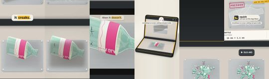 |
| `reels/c1-glass-ad-uk.mp4` | 11.8 s, 1080×1920 h264 High 30/1 fps, AAC 48000 Hz 2 ch, -14.6 LUFS / -1.6 dBTP, 4.8 MB | C1 ad-uk: Organic Reel (teaser, Post 0) and Meta ad. Object first, then the phone. | "it creaks." | 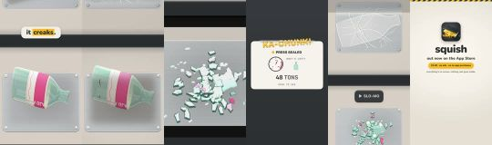 |
| `reels/c1-glass-ad-us.mp4` | 11.8 s, 1080×1920 h264 High 30/1 fps, AAC 48000 Hz 2 ch, -14.6 LUFS / -1.6 dBTP, 4.8 MB | C1 ad-us: Organic Reel (teaser, Post 0) and Meta ad. Object first, then the phone. | "it creaks." |  |
| `reels/c1-glass-cover.png` | 1080×1920 PNG | C1 cover frame (the mid-break frame with the hook) | | 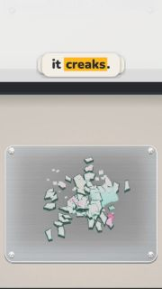 |
| `reels/c2-duo-flex-organic.mp4` | 13.6 s, 1080×1920 h264 High 30/1 fps, AAC 48000 Hz 2 ch, -14.7 LUFS / -1.4 dBTP, 5.6 MB | C2 organic: Launch-day Reel (Post 1) and the £2,000-joke ad. Real hands later: S4, S6, S7, S11. | "my £2,000 hydraulic press" | 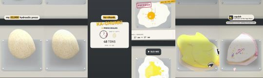 |
| `reels/c2-duo-flex-ad-uk.mp4` | 14.3 s, 1080×1920 h264 High 30/1 fps, AAC 48000 Hz 2 ch, -14.7 LUFS / -1.9 dBTP, 5.9 MB | C2 ad-uk: Launch-day Reel (Post 1) and the £2,000-joke ad. Real hands later: S4, S6, S7, S11. | "my £2,000 hydraulic press" | 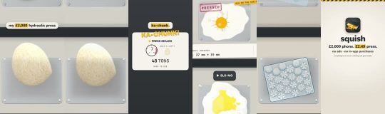 |
| `reels/c2-duo-flex-ad-us.mp4` | 14.3 s, 1080×1920 h264 High 30/1 fps, AAC 48000 Hz 2 ch, -14.7 LUFS / -1.9 dBTP, 5.8 MB | C2 ad-us: Launch-day Reel (Post 1) and the £2,000-joke ad. Real hands later: S4, S6, S7, S11. | "my $2,000 hydraulic press" | 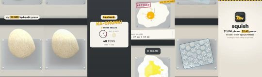 |
| `reels/c2-duo-flex-cover.png` | 1080×1920 PNG | C2 cover frame (the mid-break frame with the hook) | | 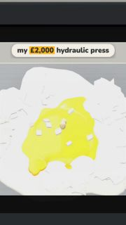 |
| `reels/c3-bubbles-organic.mp4` | 7.4 s, 1080×1920 h264 High 30/1 fps, AAC 48000 Hz 2 ch, -14.6 LUFS / -1.5 dBTP, 4.0 MB | C3 organic: ASMR loop Reel (Post 2, sound on) and the ASMR ad. Organic has no end card: a corner wordmark only. | "24 bubbles. one at a time." | 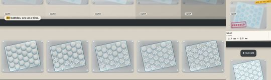 |
| `reels/c3-bubbles-ad-uk.mp4` | 8.4 s, 1080×1920 h264 High 30/1 fps, AAC 48000 Hz 2 ch, -14.7 LUFS / -1.5 dBTP, 4.4 MB | C3 ad-uk: ASMR loop Reel (Post 2, sound on) and the ASMR ad. Organic has no end card: a corner wordmark only. | "24 bubbles. one at a time." | 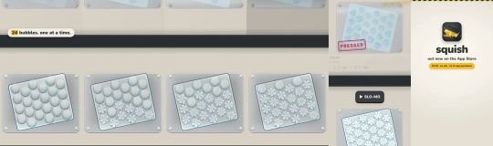 |
| `reels/c3-bubbles-ad-us.mp4` | 8.4 s, 1080×1920 h264 High 30/1 fps, AAC 48000 Hz 2 ch, -14.7 LUFS / -1.5 dBTP, 4.4 MB | C3 ad-us: ASMR loop Reel (Post 2, sound on) and the ASMR ad. Organic has no end card: a corner wordmark only. | "24 bubbles. one at a time." |  |
| `reels/c3-bubbles-cover.png` | 1080×1920 PNG | C3 cover frame (the mid-break frame with the hook) | | 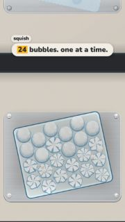 |
| `reels/c4-every-iphone-organic.mp4` | 10.3 s, 1080×1920 h264 High 30/1 fps, AAC 48000 Hz 2 ch, -14.7 LUFS / -1.3 dBTP, 6.8 MB | C4 organic: THE main ad cut (every iPhone), and Post 4. The finger is a touch indicator until the founder's S10. | "no foldable? drag it." | 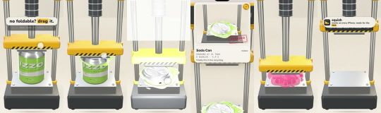 |
| `reels/c4-every-iphone-ad-uk.mp4` | 10.3 s, 1080×1920 h264 High 30/1 fps, AAC 48000 Hz 2 ch, -14.7 LUFS / -1.3 dBTP, 6.7 MB | C4 ad-uk: THE main ad cut (every iPhone), and Post 4. The finger is a touch indicator until the founder's S10. | "no foldable? drag it." |  |
| `reels/c4-every-iphone-ad-us.mp4` | 10.3 s, 1080×1920 h264 High 30/1 fps, AAC 48000 Hz 2 ch, -14.7 LUFS / -1.3 dBTP, 6.7 MB | C4 ad-us: THE main ad cut (every iPhone), and Post 4. The finger is a touch indicator until the founder's S10. | "no foldable? drag it." | 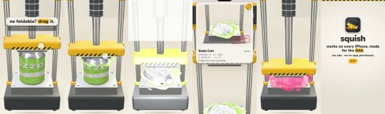 |
| `reels/c4-every-iphone-cover.png` | 1080×1920 PNG | C4 cover frame (the mid-break frame with the hook) | | 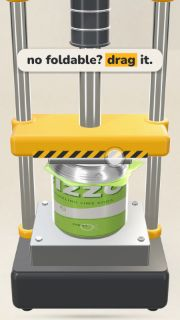 |
| `reels/c5-lineup-organic.mp4` | 15.0 s, 1080×1920 h264 High 30/1 fps, AAC 48000 Hz 2 ch, -15 LUFS / -3.7 dBTP, 6.1 MB | C5 organic: Comment-prompt Reel (Post 3) and the line-up ad. No phone in frame: app renders only. | "which one goes first?" | 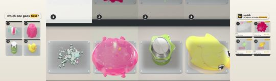 |
| `reels/c5-lineup-ad-uk.mp4` | 14.9 s, 1080×1920 h264 High 30/1 fps, AAC 48000 Hz 2 ch, -14.7 LUFS / -1.3 dBTP, 6.0 MB | C5 ad-uk: Comment-prompt Reel (Post 3) and the line-up ad. No phone in frame: app renders only. | "which one goes first?" |  |
| `reels/c5-lineup-ad-us.mp4` | 14.9 s, 1080×1920 h264 High 30/1 fps, AAC 48000 Hz 2 ch, -14.7 LUFS / -1.3 dBTP, 6.0 MB | C5 ad-us: Comment-prompt Reel (Post 3) and the line-up ad. No phone in frame: app renders only. | "which one goes first?" | 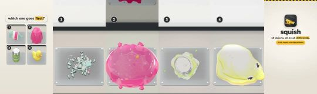 |
| `reels/c5-lineup-cover.png` | 1080×1920 PNG | C5 cover frame (the mid-break frame with the hook) | | 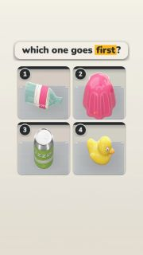 |
| `reels-week3+/c6-fights-back-organic.mp4` **(WEEK 3+)** | 9.6 s, 1080×1920 h264 High 30/1 fps, AAC 48000 Hz 2 ch, -14.5 LUFS / -2.3 dBTP, 6.8 MB | C6 organic: WEEK 3+ ONLY (founder approved 26 Oct). The secret steel ball: the P-48's yellow ram cracks, never the phone. | "this one fights back." | 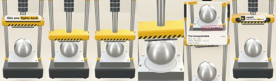 |
| `reels-week3+/c6-fights-back-ad-uk.mp4` **(WEEK 3+)** | 9.9 s, 1080×1920 h264 High 30/1 fps, AAC 48000 Hz 2 ch, -14.5 LUFS / -2.6 dBTP, 6.6 MB | C6 ad-uk: WEEK 3+ ONLY (founder approved 26 Oct). The secret steel ball: the P-48's yellow ram cracks, never the phone. | "this one fights back." | 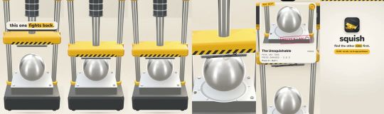 |
| `reels-week3+/c6-fights-back-ad-us.mp4` **(WEEK 3+)** | 9.9 s, 1080×1920 h264 High 30/1 fps, AAC 48000 Hz 2 ch, -14.5 LUFS / -2.6 dBTP, 6.6 MB | C6 ad-us: WEEK 3+ ONLY (founder approved 26 Oct). The secret steel ball: the P-48's yellow ram cracks, never the phone. | "this one fights back." |  |
| `reels-week3+/c6-fights-back-cover.png` | 1080×1920 PNG | C6 cover frame (the mid-break frame with the hook) | | 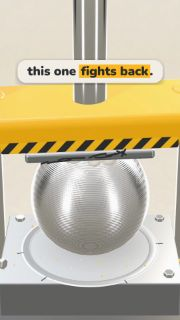 |

### Story clips (1080 × 1920; text inside y 270–1536)

| File | Spec | Use | Contact sheet |
|---|---|---|---|
| `stories/story-1-1-its-out.mp4` | 13.6 s, H.264 + AAC, -14.7 LUFS | Story sequence 1, frame 1 (no sticker). | 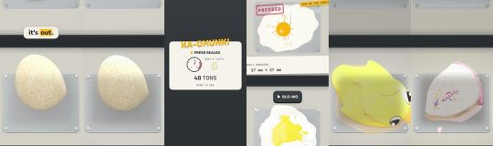 |
| `stories/story-1-3-every-iphone.mp4` | 10.3 s, H.264 + AAC, -14.7 LUFS | Story sequence 1, frame 3: add the emoji slider 🗜️ "how satisfying?" in the reserved space. | 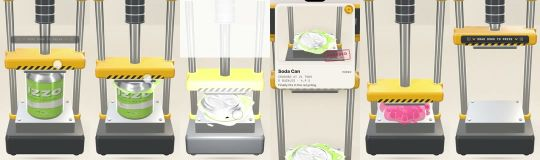 |
| `stories/story-2-4-glass-answer.mp4` | 8.0 s, H.264 + AAC, -14.5 LUFS | Story sequence 2, frame 4: the answer to the quiz (the glass bottle has the longest creak). | 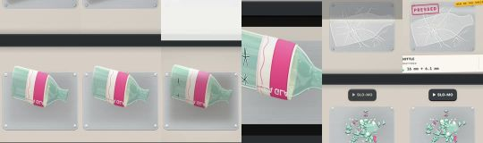 |
| `stories/story-3-3-gentle-close.mp4` | 7.5 s, H.264 + AAC, -15 LUFS | Story sequence 3, frame 3 (until the founder's S2). | 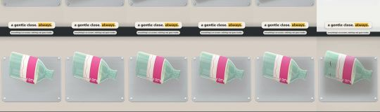 |

### Launch carousel (1080 × 1350, 4:5; post the slides in order)

| File | Thumbnail |
|---|---|
| `feed/carousel/01-hero.png` | 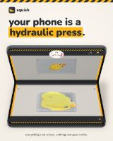 |
| `feed/carousel/02-how-it-works.png` | 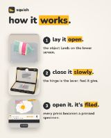 |
| `feed/carousel/03-ten-objects.png` | 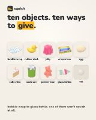 |
| `feed/carousel/04-each-gives.png` | 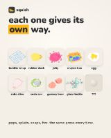 |
| `feed/carousel/05-specimens.png` | 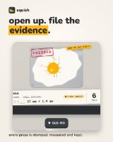 |
| `feed/carousel/06-shelf.png` | 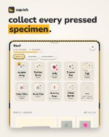 |
| `feed/carousel/07-every-iphone.png` | 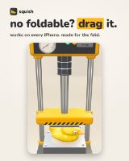 |
| `feed/carousel/08-get-it.png` | 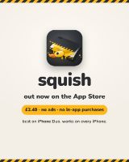 |

### Single posts (1080 × 1350)

| File | Thumbnail |
|---|---|
| `feed/post-1-glass.png` | 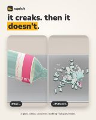 |
| `feed/post-2-duck.png` | 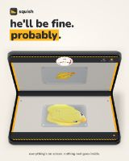 |
| `feed/post-3-can.png` | 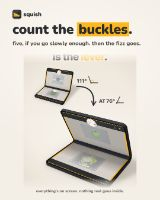 |

### Story stills (1080 × 1920); the `stories/guides/` copies mark the sticker spaces

| File | Thumbnail |
|---|---|
| `stories/story-1-2-shelf.png` | 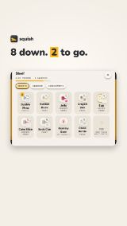 |
| `stories/story-1-4-card.png` | 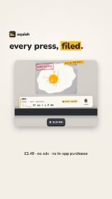 |
| `stories/story-2-1-glass-or-jelly.png` | 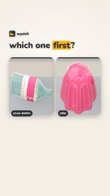 |
| `stories/story-2-2-can-or-duck.png` | 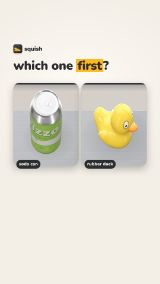 |
| `stories/story-2-3-quiz.png` | 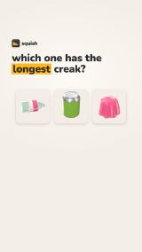 |
| `stories/story-2-5-link.png` | 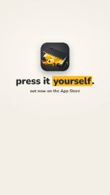 |
| `stories/story-3-1-quiz.png` | 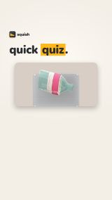 |
| `stories/story-3-2-golden-rule.png` | 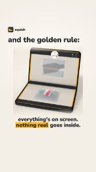 |
| `stories/story-3-4-whats-next.png` | 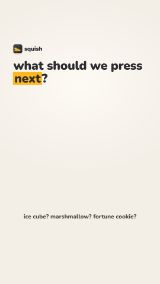 |

### Profile kit

| File | Thumbnail |
|---|---|
| `profile/avatar-1080.png` | 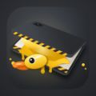 |
| `profile/avatar-320.png` | 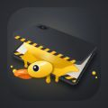 |
| `profile/highlight-how-it-works.png` | 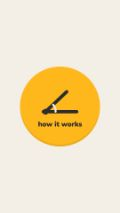 |
| `profile/highlight-objects.png` | 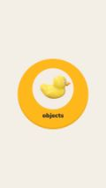 |
| `profile/highlight-press.png` | 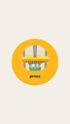 |
| `profile/highlight-safety.png` | 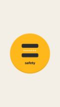 |
| `profile/highlight-specimens.png` | 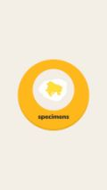 |
<!-- /GENERATED -->
